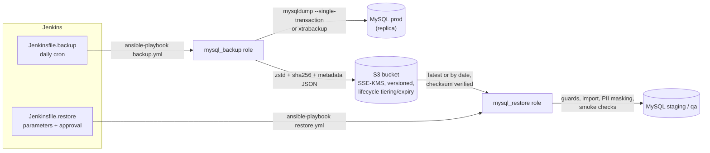

# mysql-backup-restore-ansible

[](https://github.com/gopisaluja/mysql-backup-restore-ansible/actions/workflows/ci.yml)
[](LICENSE)

Ansible roles and Jenkins pipelines for automated MySQL backups to Amazon S3 and
self-service, guarded restores into non-production environments.

- **Backups** run daily from Jenkins: consistent dumps (`mysqldump --single-transaction`,
  or Percona XtraBackup), zstd/gzip compression, SHA-256 checksum, a metadata JSON,
  and an upload to S3 with SSE-KMS under a date-based key layout.
- **Restores** are requested by developers through a parameterised Jenkins job with
  an approval step. The role resolves the latest (or a dated) backup, verifies its
  checksum, refuses protected environments, imports it, masks PII and runs smoke checks.
- **Storage** is a small Terraform module: a versioned, KMS-encrypted, private bucket
  whose lifecycle rules handle tiering and retention, plus least-privilege IAM
  policies for the backup writer and the restore reader.

This is a reference implementation of the pattern; hostnames, bucket names and
credentials in it are placeholders.

## How it fits together



## Repository layout

```text
.
├── ansible.cfg
├── collections/requirements.yml       # amazon.aws, ansible.mysql (version ranges)
├── inventories/example/               # hosts.yml + group_vars with placeholders
├── playbooks/
│   ├── backup.yml
│   └── restore.yml                    # play 1 validates the request on localhost
├── roles/
│   ├── mysql_backup/                  # dump -> verify -> checksum -> S3 -> metadata
│   └── mysql_restore/                 # guards -> fetch -> verify -> import -> mask -> smoke
├── jenkins/
│   ├── Jenkinsfile.backup             # cron, credentials binding, archive metadata, notify
│   └── Jenkinsfile.restore            # parameters, four-eyes approval, notify
├── terraform/s3-backup-bucket/        # bucket, KMS, lifecycle, bucket policy, IAM policies
├── docs/restore-drill.md              # monthly drill procedure and RTO/RPO record
└── .github/workflows/ci.yml           # yamllint, syntax-check, ansible-lint, terraform validate
```

## Quick start

### 1. Create the bucket

```hcl
module "mysql_backups" {
  source      = "./terraform/s3-backup-bucket"
  bucket_name = "acme-mysql-backups-prod"
  tags        = { team = "platform", data-classification = "confidential" }
}

# Attach module.mysql_backups.backup_writer_policy_arn to the backup host's role
# and module.mysql_backups.restore_reader_policy_arn to the restore targets' role.
```

### 2. Prepare the controller

```bash
python3 -m pip install ansible-core ansible-lint yamllint
ansible-galaxy collection install -r collections/requirements.yml   # into ./collections (git-ignored)
```

Managed hosts need the MySQL client tools (`mysql`, `mysqldump` or `xtrabackup`),
`python3` and outbound access to S3. The roles install `zstd`/`gzip` and create a
small virtualenv with `boto3` (and `PyMySQL` on restore targets), because
`amazon.aws` requires a newer SDK than most distributions ship.

### 3. Inventory and secrets

Copy `inventories/example` to `inventories/<site>`, replace the placeholders and
put the database credentials in an encrypted vault file:

```bash
ansible-vault create inventories/<site>/group_vars/all/vault.yml
```

```yaml
vault_mysql_backup_user: backup
vault_mysql_backup_password: "<from your secret store>"
vault_mysql_restore_user: restore
vault_mysql_restore_password: "<from your secret store>"
```

Minimal MySQL grants:

```sql
-- On the backup source (global SELECT also covers routines on MySQL 8.0.20+)
CREATE USER 'backup'@'127.0.0.1' IDENTIFIED BY '...';
GRANT SELECT, SHOW VIEW, TRIGGER, EVENT ON *.* TO 'backup'@'127.0.0.1';

-- On non-prod restore targets: full rights on the schemas it may replace
CREATE USER 'restore'@'127.0.0.1' IDENTIFIED BY '...';
GRANT ALL PRIVILEGES ON `app\_db%`.* TO 'restore'@'127.0.0.1';
```

XtraBackup needs additional privileges (`BACKUP_ADMIN`, `PROCESS`, `RELOAD`,
`LOCK TABLES`, `REPLICATION CLIENT`); see the Percona documentation.

### 4. Run

```bash
# Back up every database listed in mysql_backup_databases
ansible-playbook -i inventories/<site>/hosts.yml playbooks/backup.yml --ask-vault-pass

# Restore the latest app_db backup into staging
ansible-playbook -i inventories/<site>/hosts.yml playbooks/restore.yml --ask-vault-pass \
  -e restore_target_env=staging -e restore_source_db=app_db

# Restore the newest backup taken on a given UTC day, into a differently named schema
ansible-playbook -i inventories/<site>/hosts.yml playbooks/restore.yml --ask-vault-pass \
  -e restore_target_env=qa -e restore_source_db=app_db \
  -e restore_backup_date=2026-10-20 -e restore_target_db=app_db_ticket_4211
```

## S3 layout and metadata

```text
s3://<bucket>/<prefix>/<env>/<db>/YYYY/MM/DD/<db>_<YYYYMMDDTHHMMSSZ>.sql.zst
s3://<bucket>/<prefix>/<env>/<db>/YYYY/MM/DD/<db>_<YYYYMMDDTHHMMSSZ>.meta.json
```

The metadata document is uploaded **after** the artifact, so its presence marks a
complete backup. The restore role only considers `*.meta.json` keys; because the
UTC timestamp sorts lexically, "latest" is simply the last key.

```json
{
  "schema_version": 1,
  "name": "app_db",
  "environment": "prod",
  "method": "mysqldump",
  "compression": "zstd",
  "source_host": "prod-db-replica-01.example.com",
  "server_version": "8.0.39",
  "tool_version": "mysqldump  Ver 8.0.39 for Linux on x86_64 (MySQL Community Server - GPL)",
  "table_count": 42,
  "size_bytes": 734003200,
  "sha256": "3b1f0c6e...",
  "created_at": "2026-10-24T01:07:12Z",
  "s3_bucket": "acme-mysql-backups-prod",
  "s3_key": "mysql/prod/app_db/2026/10/24/app_db_20261024T010712Z.sql.zst"
}
```

## Variables

The full, commented lists live in `roles/*/defaults/main.yml`. The most important:

### mysql_backup

| Variable | Default | Purpose |
|----------|---------|---------|
| `mysql_backup_method` | `mysqldump` | `mysqldump` (logical, per DB) or `xtrabackup` (physical, whole instance) |
| `mysql_backup_databases` | `[]` | Databases to dump |
| `mysql_backup_env` | `{{ env_name }}` | Environment segment of the S3 key |
| `mysql_backup_login_user` / `_password` | `""` | From Vault; rendered into a 0600 option file with `no_log` |
| `mysql_backup_client_cnf` | `/root/.my.backup.cnf` | `~/.my.cnf`-style option file passed with `--defaults-file` |
| `mysql_backup_compression` / `_level` | `zstd` / `3` | `zstd` or `gzip` |
| `mysql_backup_mysqldump_extra_opts` | `--set-gtid-purged=OFF`, `--no-tablespaces` | Site-specific mysqldump flags |
| `mysql_backup_verify_dump` | `true` | Decompress and check the `-- Dump completed` trailer |
| `mysql_backup_s3_bucket` / `_prefix` / `_region` | `""` / `mysql` / `""` | Destination |
| `mysql_backup_s3_kms_key_id` | `""` | Empty: bucket default SSE-KMS key; or a key ARN |
| `mysql_backup_keep_local` / `_local_retention_days` | `false` / `3` | Optional local copies with age-based pruning |
| `mysql_backup_slack_webhook_url` | `""` | Failure hook (empty disables) |
| `mysql_backup_fetch_metadata_to` | `""` | Controller directory for metadata JSON (CI archiving) |

### mysql_restore

| Variable | Default | Purpose |
|----------|---------|---------|
| `mysql_restore_source_env` / `_source_db` | `prod` / `""` | Which backups to search |
| `mysql_restore_backup_date` | `latest` | `latest` or `YYYY-MM-DD` (newest backup of that UTC day) |
| `mysql_restore_backup_key` | `""` | Exact `*.meta.json` key; overrides the date |
| `mysql_restore_target_db` | source DB name | Schema to replace on the target host |
| `mysql_restore_target_env` | `{{ env_name }}` | Host environment from inventory, never from the requester |
| `mysql_restore_requested_env` | `""` | Requested environment; must equal the inventory value |
| `mysql_restore_protected_envs` | `[prod, production]` | Refused as targets (by `env_name` and by group membership) |
| `mysql_restore_allow_protected_env` | `false` | Break-glass override for one approved run |
| `mysql_restore_allow_same_source` | `false` | Allow overwriting the database the backup came from |
| `mysql_restore_db_profiles` | `{}` | Per-DB `masking_template`, `min_rows`, custom smoke `queries` |
| `mysql_restore_require_masking` | `false` | Fail early if the DB has no masking template (`true` in the example inventory) |
| `mysql_restore_strip_definers` | `true` | Rewrite `DEFINER=` to `CURRENT_USER` during import |
| `mysql_restore_skip_if_unchanged` | `false` | Skip the import when the marker shows the same backup SHA-256 |
| `mysql_restore_report_to` | `""` | Controller directory for the JSON restore report |

## Jenkins

| Pipeline | Trigger | Highlights |
|----------|---------|------------|
| `jenkins/Jenkinsfile.backup` | `cron('H 1 * * *')` | Credentials binding (SSH key, Vault password file, Slack webhook), `disableConcurrentBuilds`, metadata JSON archived, Slack on `failure` / `fixed` |
| `jenkins/Jenkinsfile.restore` | Manual, parameterised | `TARGET_ENV` offers only non-prod choices and is re-validated; input step restricted to `db-restore-approvers` with a check that the requester is not the approver; no executor held while waiting; restore report archived |

Expected credentials: `ansible-ssh-key` (SSH username with private key),
`ansible-vault-password` (secret file), `slack-webhook-db-ops` (secret text).
Agents labelled `ansible` need ansible-core, python3 and curl. AWS access is
granted to the managed hosts through their instance role, not to Jenkins.

## Security notes

- **No plaintext secrets in the repository.** Database credentials come from
  Ansible Vault; the Vault password, SSH key and Slack webhook come from the
  Jenkins credential store. Credentials are written only to a root-owned 0600
  option file (`no_log: true`), never passed as command-line arguments where
  `ps` or logs could expose them.
- **Pipeline hygiene.** `sh` steps are single-quoted so secrets are expanded by
  the shell rather than interpolated by Groovy; free-text parameters reach Slack
  through an environment variable and JSON encoding, not string splicing.
- **Least privilege in AWS.** The backup writer can put objects but cannot read
  or delete them; the restore reader can read but not write. Neither can delete
  objects or versions; expiry is left to lifecycle rules. KMS use is limited to
  the backup key via `kms:ViaService`.
- **Bucket hardening.** Public access block, `BucketOwnerEnforced` (ACLs off),
  versioning, default SSE-KMS with bucket keys, TLS-only bucket policy, and
  uploads with a non-KMS encryption header or a foreign KMS key are denied.
- **Restore guards.** Four independent layers must all agree before a restore
  runs (Jenkins choices, approval, inventory group, role guard); see below.
- **PII.** Masking is configured per environment and database in inventory, not
  chosen per request, and smoke queries can assert that masking happened.
- **Integrity.** SHA-256 computed before upload, stored in metadata and in S3
  object metadata, and verified after download; a mismatch stops the restore.

## Design decisions & trade-offs

**mysqldump vs XtraBackup (logical vs physical).** Logical dumps are portable
across MySQL versions and hosts, can be restored per database and under a
different name, compress well, and make masking straightforward because the data
passes through SQL. Their weakness is restore time: every row is re-inserted and
every index rebuilt, so restores slow down noticeably as data grows into hundreds
of GB. XtraBackup copies InnoDB pages, so backup and restore scale with disk
throughput, and it is the natural basis for point-in-time recovery, but it
backs up the whole instance, requires the same major version on restore, needs a
`prepare` step and a stopped server, and is a poor fit for "give me a masked
copy of one schema in staging". This repository therefore defaults to
mysqldump, supports XtraBackup for producing physical backups, and deliberately
keeps physical restores a documented manual procedure.

**Dump to local disk, then upload.** Streaming straight into S3 needs no local
space, but staging the compressed file first allows verifying the dump (trailer
check), computing the checksum before upload and retrying an upload without
re-dumping. The cost is free disk space for one compressed artifact.

**zstd by default.** Similar or better ratios than gzip at a fraction of the CPU
time, multi-threaded (`-T0`); gzip remains available for hosts without zstd.

**S3 lifecycle instead of script-based retention.** A cleanup script only runs
when the job runs and needs delete permissions on the bucket. Lifecycle rules are
enforced by S3 itself, survive CI outages, keep IAM free of delete rights, and
make retention reviewable in Terraform. Local pruning exists only for optional
local copies. The archive tier defaults to Glacier Instant Retrieval so that any
retained backup is restorable by the same automation; Glacier Flexible Retrieval
or Deep Archive are cheaper but need a separate restore request that takes hours.

**Metadata JSON as the completion marker.** Listing artifacts alone cannot
distinguish a finished upload from an interrupted one, and S3 object metadata is
awkward to query. Writing a small JSON document last gives the restore side one
reliable signal plus everything it needs to verify the artifact (checksum,
table count, method, compression) without downloading it first.

**Why restore guards and masking.** The most damaging mistake in this workflow is
restoring over production, or copying production PII into an environment with
weaker controls. The guards are layered so no single typo or misconfiguration is
enough: the Jenkins job does not offer prod, a second person approves, the
playbook only targets the `mysql_restore_targets` group, and the role trusts the
host's inventory `env_name` and group membership over anything the requester
typed. A break-glass override exists but must be set explicitly. Masking runs
before smoke checks or any developer access, and the example inventory refuses
to restore a database that has no masking template.

**Drop and recreate the target.** Restoring over an existing schema leaves stale
tables that are not in the dump. Recreating it gives an exact copy, at the cost
of the target being unavailable during the import, which is acceptable for
non-production environments. `DEFINER` clauses are rewritten so views, triggers
and routines import even when production accounts do not exist downstream.

**Idempotency.** Guards, lookups and smoke checks are read-only. The import is
not a no-op on re-run by design: it resets the target to the chosen backup, so the
same inputs always converge to the same state. A marker per target database
records the restored backup's SHA-256, and `mysql_restore_skip_if_unchanged`
turns repeated requests for the same backup into a no-op.

**RPO and RTO.** With daily logical backups the worst-case RPO is about 24 hours
plus the backup duration; a lower RPO needs binary-log shipping or PITR, which is
out of scope here. RTO is dominated by download plus import time and is best
learned by measuring it rather than estimating: every restore writes a report
with `duration_seconds`, `import_seconds` and `data_age_hours`, and
[docs/restore-drill.md](docs/restore-drill.md) describes a monthly drill that
records RTO/RPO against agreed targets.

**Not covered.** Binary-log based point-in-time recovery, automated physical
restores, S3 Object Lock (WORM) retention, and cross-region replication of the
bucket. Each is a reasonable extension depending on compliance requirements.

## CI

`.github/workflows/ci.yml` runs on every push and pull request:

- `yamllint --strict .`
- `ansible-playbook --syntax-check` for both playbooks
- `ansible-lint` with the `production` profile
- `terraform fmt -check`, `terraform init -backend=false` and `terraform validate`

Tool versions are pinned in the workflow so local and CI results match.

## License

[MIT](LICENSE)
